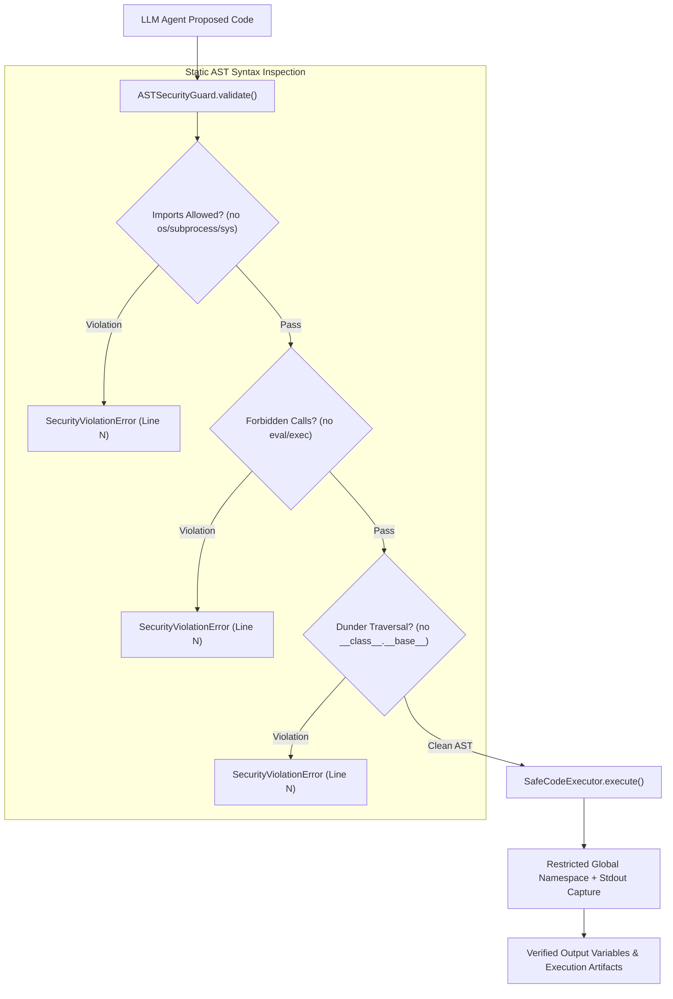

# Agent Security Sandbox 🛡️

[](https://www.python.org/downloads/)
[](https://opensource.org/licenses/MIT)
[](https://github.com/pokushko/agent-security-sandbox)
[](https://github.com/pokushko/agent-security-sandbox)
[](https://github.com/pokushko/awesome-autonomous-agent-resilience)

A production-grade AST inspection and execution containment toolkit for LLM-based autonomous agent loops. Protects host environments against untrusted LLM code mutations, unauthorized system calls, dunder escape exploits, and adversarial prompt injections.

Authored by **Roman Pokushko** ([@pokushko](https://github.com/pokushko)).



---

## ⚡ The Security Problem

When autonomous agents are granted code interpreter tools or dynamic mutation rights (e.g. self-evolving agents, scientific solvers), LLMs can generate:
1. **Accidental Host Damage:** Recursive filesystem deletions (`shutil.rmtree`, `rm -rf`).
2. **Adversarial Prompt Escapes:** Python dunder attribute traversal (`().__class__.__base__.__subclasses__()`) to bypass standard sandbox globals.
3. **Information Exfiltration:** Background socket bindings and network exfiltration via dynamic imports (`__import__('socket')`).

**Agent Security Sandbox** enforces zero-trust pre-flight verification: the code is parsed into Python's Abstract Syntax Tree (AST) and rigorously audited before a single byte is ever passed to the Python interpreter.

---

## 🚀 Key Modules

* **`ASTSecurityGuard`:** Static visitor inspecting import modules, dynamic call identifiers, and dunder traversal chains.
* **`PromptSanitizer`:** Scans incoming user/agent prompts for jailbreak patterns and automatically redacts leaked API keys and tokens.
* **`SafeCodeExecutor`:** Executes verified AST code blocks inside an isolated, stripped namespace with deterministic stdout capturing.

---

## 💻 Quickstart

### Installation

```bash
git clone https://github.com/pokushko/agent-security-sandbox.git
cd agent-security-sandbox
pip install -e .
```

### Usage Example

```python
from security_sandbox import ASTSecurityGuard, SecurityViolationError, SafeCodeExecutor

guard = ASTSecurityGuard()
malicious_code = "import os; os.system('whoami')"

try:
    guard.validate(malicious_code)
except SecurityViolationError as err:
    print(f"Intercepted attack: {err}")

# Safe mathematical calculation
executor = SafeCodeExecutor()
clean_code = """
scores = [0.92, 0.88, 0.95]
avg_score = sum(scores) / len(scores)
"""
result = executor.execute(clean_code)
print("Result:", result["variables"]["avg_score"])
```

---

## 🧪 Verification & Tests

To run the complete validation test suite:

```bash
pytest tests/ -v
```

All 6 test suites verify:
- Forbidden module imports (`os`, `sys`, `subprocess`, `shutil`).
- Dynamic evaluation interception (`eval`, `exec`).
- Dunder traversal escape blocking.
- Prompt injection and jailbreak detection.
- Credential leak redaction (`sk-...`, `ghp_...`).
- Sandboxed computational execution.

---

## 🌐 EvoNova Labs Open-Source Ecosystem

Part of the **[EvoNova Labs](https://pokushko.github.io)** open-source AI resilience & scientific integrity stack by **[Roman Pokushko](https://github.com/pokushko)**:

| Project | Role in Stack | Link |
| :--- | :--- | :--- |
| **Awesome Agent Resilience** | Curated index (`160` entries), MAST/OWASP Failure Taxonomy & `F01–F10` chaos benchmark | [pokushko/awesome-autonomous-agent-resilience](https://github.com/pokushko/awesome-autonomous-agent-resilience) |
| **AgentBunker** | 24/7 WAL intent journal, RSS memory ceiling watchdog & tri-state circuit breakers | [pokushko/agent-bunker](https://github.com/pokushko/agent-bunker) |
| **Orchestration Engine** | Zero-dependency `asyncio` MAS router, Kahn DAG waves & consensus reducers | [pokushko/orchestration-engine](https://github.com/pokushko/orchestration-engine) |
| **Agent Security Sandbox** | Pre-flight Python AST guard against dunder escapes & prompt-injection sanitizer | [pokushko/agent-security-sandbox](https://github.com/pokushko/agent-security-sandbox) |
| **Agentic Vector Memory** | Dual-store episodic & semantic memory with exponential decay & SQLite persistence | [pokushko/agentic-vector-memory](https://github.com/pokushko/agentic-vector-memory) |
| **EvoNova Causal Guard** | Pearl *do*-calculus DAG verifier, Tabu memory & multi-agent debate arbiter | [pokushko/evonova-causal-guard](https://github.com/pokushko/evonova-causal-guard) |
| **Sci Integrity Guard** | Cross-table numeric parity linter, CrossRef/OpenAlex DOI checker & LaTeX-to-OMML | [pokushko/sci-integrity-guard](https://github.com/pokushko/sci-integrity-guard) |
| **KTK ELOU-AVT Core** | Industrial cybernetic digital twin prototype for crude oil ELOU-AVT units | [pokushko/ktk_elou_avt_core](https://github.com/pokushko/ktk_elou_avt_core) |
| **EvoNova Chem Core** | RDKit molecular descriptor screening core for physical constraint enforcement | [pokushko/evonova-chem-core](https://github.com/pokushko/evonova-chem-core) |

---

## 📄 License

MIT License. Free for open research and commercial autonomous agent deployment.
